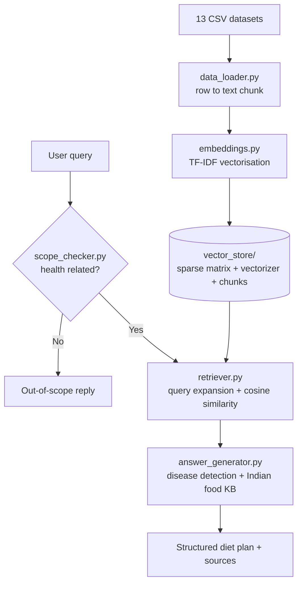

<div align="center">

# 🥗 MediFood AI

### A RAG-Based Personalised Health & Nutrition Chatbot for Disease-Specific Indian Diet Recommendations


</div>

---

## Overview

**MediFood AI** is a self-contained chatbot that answers health and nutrition questions and produces **disease-specific Indian diet plans**. It uses a pure **Retrieval-Augmented Generation (RAG)** pipeline built on foundational machine learning concepts: **TF-IDF vectorisation** and **cosine similarity**. It needs no external LLM, no API key and no internet connection to run.

All knowledge comes from **13 curated CSV datasets** that the developer pre-loads and indexes, so users never upload any files. The system retrieves the most relevant records for a query and combines them with disease-specific Indian food knowledge to generate a structured response.

> **Example query:** *"I have diabetes and high BP, what should I eat today?"*
> **Response:** foods to avoid, recommended Indian foods, a timed daily meal plan, lifestyle tips, supplements to discuss with a doctor, and a medical disclaimer.

## Key Features

| Feature | Description |
|---|---|
| **Pure RAG pipeline** | TF-IDF embeddings and cosine similarity retrieval over 8,264 indexed records |
| **Disease-aware answers** | Detects conditions in the query and keeps the response scoped to them |
| **Indian diet focus** | Foods such as ragi, bajra, karela, methi, amla, lauki and dal, with quantities and timings |
| **Personalisation** | Age, gender, weight, height, live BMI, known conditions and allergies feed into each answer |
| **Scope enforcement** | Off-topic questions are politely declined as out of scope |
| **Source transparency** | Each answer lists the retrieved records and their similarity scores |
| **Authentication** | Signup and login with hashed passwords and session management |
| **Zero external dependencies** | No API keys, no cloud services, no GPU |

## System Architecture



**Offline phase (once):** CSV rows become text chunks, the chunks become TF-IDF vectors, and the vectors are saved as the vector database.
**Online phase (per query):** scope check, query expansion, vectorisation, cosine similarity search (top-5), then answer generation.

## Machine Learning Concepts

| Concept | Where it is used |
|---|---|
| **TF-IDF vectorisation** | Converts every chunk and every query into numeric vectors (10,000 features, unigrams and bigrams, sublinear TF) |
| **Cosine similarity** | Ranks stored records by closeness to the query vector |
| **L2 normalisation** | Makes cosine similarity equal to a simple dot product |
| **Query expansion** | Adds disease-specific terms to the query to improve recall |
| **Source boosting** | Up-weights records from nutrition and diet datasets (1.4x) |
| **Diversity filtering** | Limits results to at most 2 records per source dataset |
| **Keyword classification** | Scope checker that restricts the bot to health and food topics |

## Project Structure

```
medifood_flask/
├── app.py                    # Flask application: routes, auth, /api/chat
├── build_vector_store.py     # One-time indexing ("training") script
├── requirements.txt
├── data/                     # 13 CSV datasets (pre-loaded by the developer)
├── vector_store/             # Pre-built TF-IDF vectorizer, sparse matrix, chunks
├── utils/
│   ├── data_loader.py        # CSV rows -> text chunks
│   ├── embeddings.py         # TF-IDF vectorisation and persistence
│   ├── retriever.py          # Query expansion and cosine similarity search
│   ├── answer_generator.py   # Disease-specific diet plan generation
│   └── scope_checker.py      # Health-only query filter
├── templates/                # Jinja2 pages: login, signup, home, chat
├── static/style.css
└── instance/users.json       # Created on first signup (hashed passwords)
```

## Getting Started

### Prerequisites
- Python 3.10 or higher
- `pip`

### Installation and run

```bash
# 1. Clone the repository
git clone https://github.com/<your-username>/medifood-ai.git
cd medifood-ai

# 2. (Recommended) create a virtual environment
python -m venv venv
venv\Scripts\activate          # Windows
# source venv/bin/activate     # macOS / Linux

# 3. Install dependencies
python -m pip install -r requirements.txt

# 4. Start the application
python app.py
```

Open **http://127.0.0.1:5000** and create an account.

The vector store is already included. To rebuild it after changing the CSV files, install `pandas` and run `python build_vector_store.py`. If `vector_store/` is deleted, the app rebuilds it automatically on startup.

## Usage

1. **Sign up** and **log in**.
2. Open **Chat** and fill in your profile (age, weight, height, conditions, allergies).
3. Ask a question, for example:
   - *I have diabetes and high BP, what should I eat today?*
   - *Heart patient Indian diet plan*
   - *PCOS diet recommendations*
   - *What Indian foods help with anaemia?*
4. Expand **Knowledge base sources** to see which records were retrieved.

Questions outside health and nutrition (for example, movies or coding) return an out-of-scope message.

## Datasets

The knowledge base is built from 13 CSV files covering food nutrition, healthy eating and meal plans, disease-to-diet mappings, personalised diet recommendations, calorie data, precautions, workouts and diabetes health indicators. Each row is converted into a plain-English chunk and tagged with its source file.

## Troubleshooting

| Problem | Solution |
|---|---|
| `ModuleNotFoundError: No module named 'flask'` | `pip` and `python` point to different installs. Use `python -m pip install -r requirements.txt` |
| `DLL load failed ... Application Control policy has blocked this file` (Windows) | Move the project out of `Downloads`, run `Get-ChildItem -Recurse \| Unblock-File`, and recreate the virtual environment |
| Vector store errors | Delete `vector_store/` and restart; it rebuilds automatically (needs `pandas`) |

## Limitations

- TF-IDF matches **keywords**, not deep meaning, so it can miss unusual phrasing. Sentence embeddings would improve this.
- Answers combine retrieved records with a curated knowledge base; they are not generated by a language model.
- Passwords are stored in a local JSON file, which suits a mini project but not production.

## Future Scope

- Replace TF-IDF with sentence-transformer embeddings
- Support uploading personal medical reports (PDF) as extra context
- Regional language support (Telugu, Hindi, Tamil)
- Move user data to a relational database
- Feedback-driven recommendations and dietary tracking

## Technology Stack

Python · Flask · scikit-learn · NumPy · SciPy · Jinja2 · Markdown · HTML/CSS/JavaScript

## Team

Mini Project, B.Tech Computer Science and Engineering, **Rajiv Gandhi University of Knowledge Technologies, Srikakulam**

| Name | Roll No. |
|---|---|
| Jyoshna Jilagam | S210651 |
| Potnuru Kavya | S210028 |
| Teketi Mounica | S210482 |
| Paluchuri Janaki Sravanthi | S210408 |
| Neelam Naga Supriya | S210339 |

## Disclaimer

MediFood AI is an educational project. Its output is general nutritional information and **not a substitute for professional medical advice**. Always consult a qualified doctor or dietitian about your condition, test reports and medications. Set a strong `SECRET_KEY` environment variable before any real deployment.
